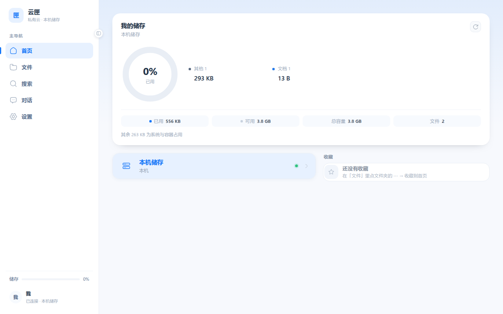

# 云匣 · Yunxia

一个自用的私有云盘前端与服务端：把**本机磁盘**、**局域网电脑的 dufs 共享**、**CloudDrive2 / Alist 之类的 WebDAV 网盘**接成同一个文件列表，配网页端和 Android App。
界面是一套干净的 iOS 风格文件管理：列表/宫格、图片查看器、播放器（倍速、手势、继续观看）、搜索、多端共享的播放进度。

> 这是一个**单用户、自用、内网/内网穿透**定位的项目，没有多租户、没有权限体系，也没打算做。
> 想要「多人多账号 + 复杂权限」，请直接用 Nextcloud / Seafile / Alist。



## 特性

- **三种储存来源，自己加**
  - `local`：服务器本机磁盘上的任意目录
  - `dufs`：电脑上跑的 [dufs](https://github.com/sigoden/dufs) 共享目录（Windows / macOS / Linux 都行）
  - `webdav`：标准 WebDAV —— CloudDrive2、Alist、Nextcloud、群晖 WebDAV 都能接
- **一个账号口令**：读接口可匿名（装上就能看），写操作要口令；令牌 30 天有效
- **文件域**：列目录（stale-while-revalidate 缓存）、上传/新建/改名/移动/删除、签名直链（Range 断点续播）
- **搜索**：SQLite FTS5 trigram，中文子串也能命中
- **缩略图**：Pillow 缩放 + 落盘缓存，手机上不再拉原图
- **继续观看**：多端共享播放进度，片头 10 秒/片尾 30 秒自动不留记录
- **对话（默认关闭）**：接任意 OpenAI 兼容服务（DeepSeek / OpenAI / 本地 Ollama …），自己在配置里填地址、模型和 Key 就能用
- **两个客户端**：`web/`（Vue 3 + Vite）、`app/`（Flutter，Android）

## 目录结构

```
server/   FastAPI 服务端（控制面 + 字节流代理）
web/      Vue 3 网页端
app/      Flutter Android 客户端
docs/     部署与配置教程（先看这里）
deploy/   Docker / systemd 部署文件
```

## 30 秒跑起来

```bash
cd server
python3 -m venv .venv && .venv/bin/pip install -r requirements.txt
cp config.example.json config.json        # 改口令、加来源
.venv/bin/python -m uvicorn app.main:app --host 0.0.0.0 --port 8686
```

浏览器打开 `http://<服务器 IP>:8686/api/v1/docs` 能看到接口表就通了。
首次启动会自动建 `data/`（数据库、令牌密钥、缩略图、对话附件）和一个默认的本机储存目录。

Docker 一条命令：

```bash
cd deploy && cp config.example.json config.json && nano config.json
docker compose up -d
```

## 接下来看

| 想做 | 看哪 |
|---|---|
| 把服务端装到 NAS / 小主机 / 树莓派，开机自启 | [docs/deploy-server.md](docs/deploy-server.md) |
| 添加「服务器本机磁盘」这个来源 | [docs/storage-local.md](docs/storage-local.md) |
| 把电脑的文件夹共享出去（dufs，含 Windows 开机自启） | [docs/storage-dufs.md](docs/storage-dufs.md) |
| 接 CloudDrive2 / 115 网盘 / Alist（WebDAV） | [docs/storage-webdav.md](docs/storage-webdav.md) |
| 打开对话，接 DeepSeek 或本地模型 | [docs/chat.md](docs/chat.md) |
| 编译网页端 / 打 Android APK | [docs/build-clients.md](docs/build-clients.md) |
| 报错自查、常见坑 | [docs/faq.md](docs/faq.md) |

## 配置一览

`server/config.json`（完整示例见 `server/config.example.json`）：

```jsonc
{
  "server": { "host": "0.0.0.0", "port": 8686, "public_base": "" },
  "auth":   { "password": "你的口令" },          // 留空 = 内网免登录（谁都能写，慎用）
  "paths":  { "data": "./data" },
  "token_days": 30,
  "sources": [
    { "id": "local", "name": "本机储存", "kind": "local",  "root": "/srv/files" },
    { "id": "pc",    "name": "电脑",     "kind": "dufs",   "base": "http://192.168.1.10:5000",
      "user": "u", "password": "p", "root": "/" },
    { "id": "cd2",   "name": "网盘",     "kind": "webdav", "base": "http://192.168.1.10:19798/dav",
      "user": "you@mail.com", "password": "p", "root": "/" }
  ],
  "chat": { "enabled": false, "base": "https://api.deepseek.com/v1",
            "api_key": "", "model": "deepseek-chat" }
}
```

- `password` 支持明文，也支持 `pbkdf2$...` 哈希（`python -m app.cli hash 你的口令` 生成，推荐）。
- 改完配置要重启服务。
- `kind` 只能是 `local` / `dufs` / `webdav`；`writable: false` 可以把某个来源设成只读。

## 安全提示

- 服务默认监听 `0.0.0.0`，**必须设口令**再放到网络上；只在内网用也要设，因为它能读写你的磁盘。
- 想从外网用，别直接把 8686 端口暴露到公网：用 WireGuard/Tailscale、或 Cloudflare Tunnel / frp 之类的隧道，再在前面套一层 HTTPS。
- 来源的账号密码是明文存在 `config.json` 里的，配置文件权限建议 `chmod 600`。

## 许可

MIT。第三方组件许可见各目录下的声明：Vue、Vite、FastAPI、Pillow、Flutter 等。
图标是自绘 SVG / 公开的 Hugeicons 线性图标，字体与表情来自各自的开源项目。
